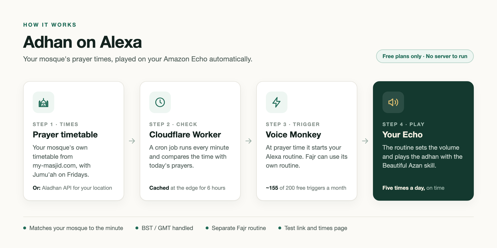
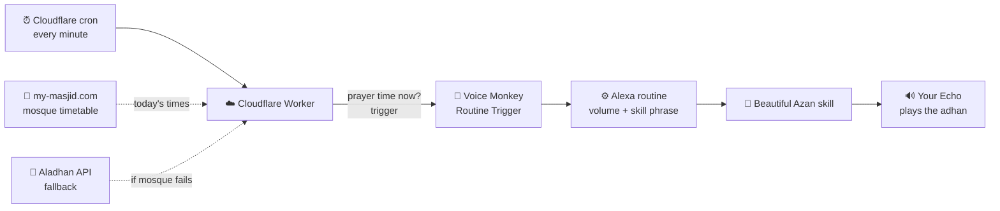
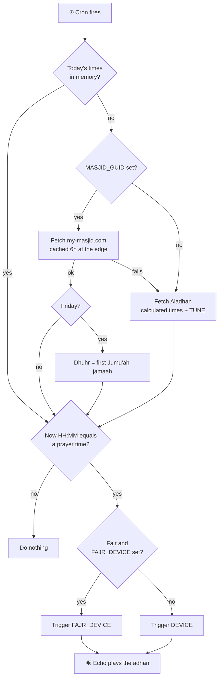
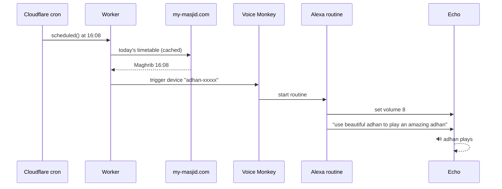

# Adhan on Alexa

Play the adhan on your Amazon Echo at every prayer time, automatically, using your own mosque's timetable. No server to run, no hardware, and it fits inside free plans.





## Features

- **Your mosque's exact times.** Reads the mosque's own yearly timetable from [my-masjid.com](https://my-masjid.com), including BST/GMT changes. If your mosque isn't on my-masjid, or it's unreachable, it uses calculated times from [Aladhan](https://aladhan.com).
- **Jumu'ah.** On Fridays, the Dhuhr adhan plays at the mosque's first Jumu'ah jamaah (with the mosque timetable only).
- **Separate Fajr routine** (optional), for example a different adhan or a lower volume.
- **Times page and test link.** Open the Worker URL to see today's times, and test the adhan whenever you want.
- **Times API for apps** (optional). JSON prayer times for phone apps, served from your own Worker. Alexa works without setting this up. See [Times API for apps](#times-api-for-apps).
- **Free.** Cloudflare Workers' free plan, plus about 155 of Voice Monkey's 200 free requests a month.

## Choose where your prayer times come from

You pick one of two options. You can switch at any time by editing [`wrangler.toml`](wrangler.toml) and running `npx wrangler deploy` again.

| | Option A: your nearest mosque (recommended) | Option B: your own location |
|---|---|---|
| **Times match** | Your mosque's printed timetable, to the minute | A calculation for your exact location |
| **Jumu'ah** | Yes, at the mosque's first jamaah | No, Dhuhr plays at normal Dhuhr time |
| **Works if** | Your mosque uses [my-masjid.com](https://my-masjid.com) (many UK mosques do, it powers their TV screens) | Anywhere in the world |
| **What to set** | `MASJID_GUID` | `LATITUDE`, `LONGITUDE`, `TIMEZONE`, `METHOD`, `SCHOOL` |

Even with Option A, set your location too. If the mosque timetable is ever unreachable, the Worker falls back to Option B for that day.

### Option A: use your nearest mosque

1. Go to [my-masjid.com](https://my-masjid.com) and search for your mosque.
2. Open its timing screen. The link contains a long code like `7a036d31-b4ac-44f6-a68e-2dbb1f7a7994`. That's the `MASJID_GUID`.
3. Check it: open `https://time.my-masjid.com/api/TimingsInfoScreen/GetMasjidTimings?GuidId=YOUR_GUID` in a browser. You should see your mosque's name.
4. In `wrangler.toml`, set `MASJID_GUID = "YOUR_GUID"`.

Not on my-masjid? Ask your mosque which service runs their prayer-time screen, or use Option B and match their timetable with `TUNE` (see below).

### Option B: use your own location

This uses the free [Aladhan API](https://aladhan.com/prayer-times-api) (`api.aladhan.com/v1/timings`). No account or key is needed.

1. Find your latitude and longitude: in [Google Maps](https://maps.google.com), right-click your home and click the numbers at the top of the menu to copy them, for example `51.5406, 0.1475`.
2. Find your timezone name, for example `Europe/London`, `Europe/Paris` or `America/New_York` ([full list](https://en.wikipedia.org/wiki/List_of_tz_database_time_zones)).
3. In `wrangler.toml`:

   ```toml
   MASJID_GUID = ""          # empty = use your location only
   LATITUDE = "51.5406"
   LONGITUDE = "0.1475"
   TIMEZONE = "Europe/London"
   METHOD = "15"             # 15 Moonsighting Committee (common in UK)
   SCHOOL = "1"              # 1 Hanafi Asr, 0 Shafi'i
   TUNE = "0,0,0,0,0,0,0,0,0"
   ```

4. *(Optional)* Match a local mosque's timetable with `TUNE`. Compare a week of the Worker's times page with the mosque's timetable, and add or take away minutes. The order is `Imsak,Fajr,Sunrise,Dhuhr,Asr,Maghrib,Sunset,Isha,Midnight`. For example, if Fajr is 6 minutes late and Isha is 7 minutes early, use `"0,-6,0,0,0,0,0,7,0"`.

Not sure which `METHOD` to use? Ask your mosque, or see the [list of methods](https://aladhan.com/calculation-methods).

## What you need

- An Amazon Echo and the Alexa app
- A free [Cloudflare](https://dash.cloudflare.com/sign-up) account
- A free [Voice Monkey](https://voicemonkey.io) account (enable its Alexa skill)
- An adhan skill on Alexa, for example **Beautiful Azan**
- [Node.js](https://nodejs.org) on your computer, to deploy

## Setup

### 1. Get the code

```bash
git clone https://github.com/tjthouhid/adhan-worker.git
cd adhan-worker
```

### 2. Voice Monkey

1. In the Voice Monkey console, open **Routine Triggers** and create a trigger, for example `adhan`.
2. Copy its **Device ID**. Voice Monkey adds a suffix, for example `adhan-ab12c`.
3. *(Optional)* Create a second trigger for Fajr and copy its Device ID too.
4. Open **API Tokens**, create a token and copy it.

### 3. Alexa routine

In the Alexa app, go to **More → Routines → +**. This is a routine that works:

```
Adhan                                   [Enabled]

WHEN
  Alexa Voice Monkey v3: VM Routines, adhan
  Any time

ALEXA WILL
  1. Set volume to 8
  2. "use beautiful adhan to play an amazing adhan"
```

To build it:

| Step | What to pick |
|---|---|
| **When this happens** | **Smart Home → Alexa Voice Monkey v3: VM Routines →** your trigger, for example `adhan` |
| Time | **Any time** (the default) |
| Action 1 *(optional)* | **Device settings → Volume →** for example `8` |
| Action 2 | **Customised →** type `use beautiful adhan to play an amazing adhan` |
| Alexa will respond from | **Your Echo.** Don't leave it on "the device you speak to". |

For Fajr, make a second routine the same way, with your Fajr trigger and a lower volume if you like.

If you use a different adhan skill, use one of the phrases on its page in the Alexa app (**Start By Saying**), without "Alexa". Say it to your Echo first to check it plays.

> Use **Customised**, not **Skills**. The Skills action only opens the skill, and it then waits for you to answer a question.

### 4. Configure

Edit [`wrangler.toml`](wrangler.toml). It comes with my settings (a mosque in Dagenham, London, and my Voice Monkey devices). **Replace them with yours**, at least `DEVICE`, `FAJR_DEVICE` and your time source from [Choose where your prayer times come from](#choose-where-your-prayer-times-come-from).

| Variable | What to set |
|---|---|
| `MASJID_GUID` | Your mosque's my-masjid.com ID (see below). Leave empty to use calculated times only. |
| `LATITUDE`, `LONGITUDE`, `TIMEZONE` | Your location, e.g. `51.5406`, `0.1475`, `Europe/London`. Used for the fallback, and `TIMEZONE` is always used. |
| `METHOD` | Calculation method for the fallback. `15` Moonsighting Committee, `3` MWL, `2` ISNA, `1` Karachi, [more](https://aladhan.com/calculation-methods) |
| `SCHOOL` | Asr for the fallback. `1` Hanafi, `0` Shafi'i |
| `LAT_ADJ` | High-latitude rule for the fallback. `3` angle-based (good for the UK) |
| `TUNE` | Minute offsets for the fallback: `Imsak,Fajr,Sunrise,Dhuhr,Asr,Maghrib,Sunset,Isha,Midnight` |
| `DEVICE` | Your Voice Monkey trigger's Device ID, e.g. `adhan-ab12c` |
| `FAJR_DEVICE` | *(Optional)* The Fajr trigger's Device ID. Leave empty to use `DEVICE` for all five prayers. |
| `MOSQUES` | *(Optional, for apps only)* The mosques served by the [Times API](#times-api-for-apps). **Not needed for Alexa.** You can leave it as it is, or set it to `'[]'`. |

To find your mosque's `MASJID_GUID` or your coordinates, see [Option A](#option-a-use-your-nearest-mosque) and [Option B](#option-b-use-your-own-location).

### 5. Deploy

```bash
npx wrangler login                  # sign in to Cloudflare in the browser
npx wrangler secret put VM_TOKEN    # paste your Voice Monkey API token
npx wrangler secret put TEST_KEY    # choose a password (letters and numbers only)
npx wrangler deploy
```

Wrangler prints your Worker URL, for example `https://adhan-alexa.<your-subdomain>.workers.dev`.

## Check it works

**Today's times.** Open the Worker URL:

```
Prayer times for 20-11-2026 (Europe/London)
Source: mosque
Now: 15:07

Fajr     05:41
Jumu'ah  12:30
Asr      14:17
Maghrib  16:08
Isha     17:42
```

`Source: mosque` means it's using your mosque's timetable. `Source: aladhan` means it's using the fallback.

**Test the adhan now.** Each test uses 1 Voice Monkey request:

```
https://adhan-alexa.<your-subdomain>.workers.dev/?test=1&key=YOUR_TEST_KEY
https://adhan-alexa.<your-subdomain>.workers.dev/?test=1&key=YOUR_TEST_KEY&fajr=1
```

**Live logs.** At prayer time you'll see a `triggered` line:

```bash
npx wrangler tail
```

## Troubleshooting

| What you see | Fix |
|---|---|
| `Forbidden` | Wrong key in the test link. Use only letters and numbers: `%`, `&`, `#`, `?` and `+` break URLs. To set a new one, run `npx wrangler secret put TEST_KEY`. |
| `Failed to trigger … 401` | Wrong Voice Monkey token. Run `npx wrangler secret put VM_TOKEN` again. |
| `Failed to trigger … 404` or "device not found" | `DEVICE` / `FAJR_DEVICE` must be the exact **Device ID**, with its suffix, e.g. `adhan-ab12c`. |
| Alexa says *"To control a video device…"* | Alexa didn't send the phrase to the skill. Use exactly `use beautiful adhan to play an amazing adhan`, and set **From** to your Echo. |
| Alexa opens the skill and asks a question | You used the **Skills** action. Use **Customised** with the full phrase instead. |
| Times are a few minutes off | Set `MASJID_GUID` to your mosque's ID, or adjust `TUNE` for the fallback. |

## Costs

- **Cloudflare Workers (free plan):** the cron runs 1,440 times a day. The free plan allows 100,000 requests a day.
- **Voice Monkey (free plan):** 5 prayers × 31 days is about 155 triggers a month, inside the 200 free requests. That leaves about 45 tests a month.
- **API calls:** timetables are cached at Cloudflare's edge for 6 hours, so my-masjid.com and Aladhan are called only a few times a day.

## How it works

[`src/index.js`](src/index.js) has two handlers:

- **`scheduled`** runs every minute. It gets today's times, using the in-memory cache first, then my-masjid.com, then Aladhan. If the current `HH:MM` in your timezone matches a prayer time, it calls Voice Monkey with the right trigger.
- **`fetch`** serves the times page and the `?test=1` link.

### Every minute



### At prayer time



### Project files

```
adhan-worker/
├── src/
│   ├── index.js      # the Worker: Alexa cron, Jumu'ah, Voice Monkey trigger, times page, routing
│   ├── api.js        # /mosques.json and /times.json
│   ├── refresh.js    # daily mosque timetable refresh into KV (one mosque per cron run)
│   ├── aladhan.js    # location-based times from the Aladhan calendar
│   ├── alexa-kv.js   # Alexa backup: the KV copy, if the mosque fetch fails
│   ├── days.js       # timezone-aware dates and building each day's times
│   ├── timetable.js  # trims a my-masjid timetable to what's stored
│   ├── mosques.js    # the MOSQUES list
│   └── validate.js   # /times.json query checks
├── test/             # unit tests (npm test)
├── wrangler.toml     # your settings: mosque ID, location, device IDs, mosque list, cron
├── README.md
└── LICENSE
```

## Times API for apps

The Worker also serves prayer times as JSON, for phone apps. Phones only ever talk to your Worker: my-masjid.com is called by the cron about **once a day per mosque**, however many people use the app, and every request is served from Cloudflare KV and cache.

### Endpoints

| URL | Returns |
|---|---|
| `/mosques.json` | The mosques you list in `MOSQUES` (id, name, city, timezone). Never their my-masjid IDs. |
| `/times.json?masjid=duwt` | That mosque's times |
| `/times.json?lat=51.54&lng=0.15` | Calculated times for a location (Aladhan). Optional: `method` (default `15`), `school` (`1` Hanafi, default, or `0`) |

Add `&days=N` for 1 to 14 days (default 7). Example response:

```json
{
  "source": "mosque",
  "mosque": { "id": "duwt", "name": "Dagenham Ummah Welfare Trust" },
  "location": null,
  "timezone": "Europe/London",
  "generatedAt": "2026-11-22T19:40:12.008Z",
  "days": [
    {
      "date": "2026-11-22",
      "weekday": "Sun",
      "fajr": "2026-11-22T05:44:00+00:00",
      "sunrise": "2026-11-22T07:29:00+00:00",
      "dhuhr": "2026-11-22T11:51:00+00:00",
      "asr": "2026-11-22T14:15:00+00:00",
      "maghrib": "2026-11-22T16:05:00+00:00",
      "isha": "2026-11-22T17:40:00+00:00",
      "jumuah": null
    }
  ]
}
```

- Every time includes its UTC offset, so BST and GMT are already handled.
- On Fridays, mosque sources also give `jumuah`, the first Jumu'ah jamaah. `dhuhr` stays the normal Dhuhr time.
- Mosque sources also give `jamaat`, the mosque's iqamah (congregation) times: `{ "fajr": "…", "dhuhr": "…", … }`, each in the same ISO format, with `null` for any prayer the mosque doesn't publish. Location sources give `jamaat: null`.
- Days after 31 December reuse this year's timetable until my-masjid publishes the new year, and are marked `"estimated": true`.
- Errors return JSON, for example `{"error": "timetable not ready"}` (503) in the first minutes after adding a mosque.

### Set it up (once)

Nothing extra. `wrangler.toml` already has a `TIMES` KV binding without an id, so your first `npx wrangler deploy` creates the KV store in your own Cloudflare account automatically (this needs Wrangler 4.45 or later, which `npx wrangler` gives you). Within a few minutes the cron fills in each mosque, and then `/times.json?masjid=...` works.

### Add a mosque

Add an entry to `MOSQUES` in `wrangler.toml` and deploy:

```toml
MOSQUES = '[{"id":"duwt","name":"Dagenham Ummah Welfare Trust","city":"Dagenham","guid":"7a036d31-b4ac-44f6-a68e-2dbb1f7a7994","timezone":"Europe/London"}, {"id":"another","name":"Another Masjid","city":"Ilford","guid":"THEIR-MY-MASJID-GUID","timezone":"Europe/London"}]'
```

The `guid` is found the same way as `MASJID_GUID` (see [Option A](#option-a-use-your-nearest-mosque)). The `id` is the short name apps use in URLs.

The Alexa adhan doesn't depend on this. It keeps reading your mosque directly as before, and uses the KV copy only as a backup if my-masjid is unreachable.

### Run the tests

```bash
npm install
npm test
```

## No Echo?

An iPhone app is in progress: it uses this Times API and iOS alarms, so the full adhan rings even on silent. [Open an issue](https://github.com/tjthouhid/adhan-worker/issues) if you'd like to try it.

## License

[MIT](LICENSE). Use it, change it and share it freely. May Allah accept it from all of us.
